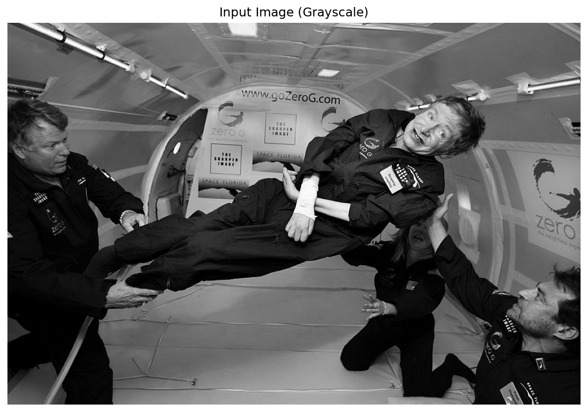
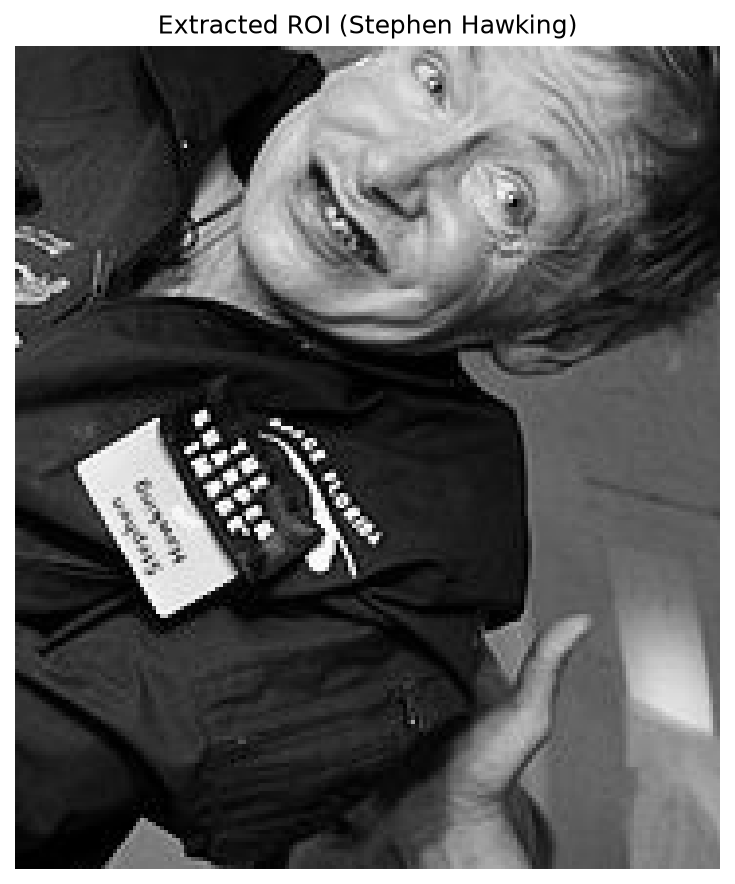
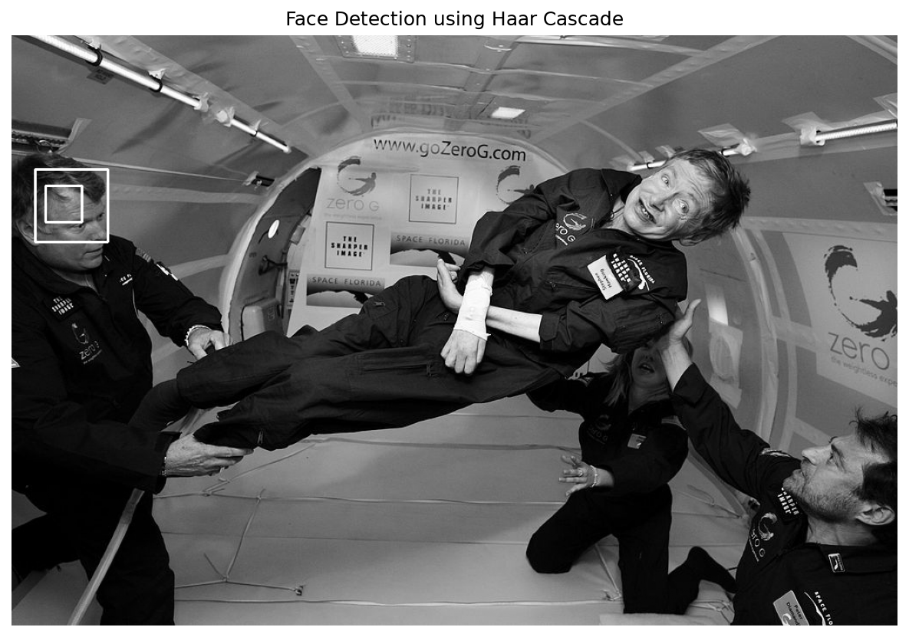
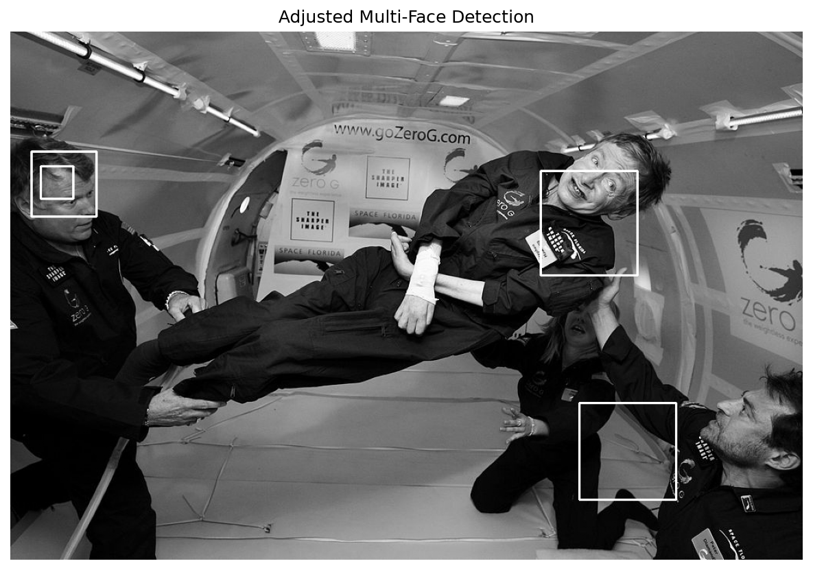
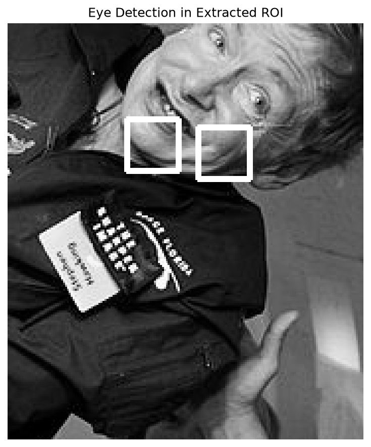
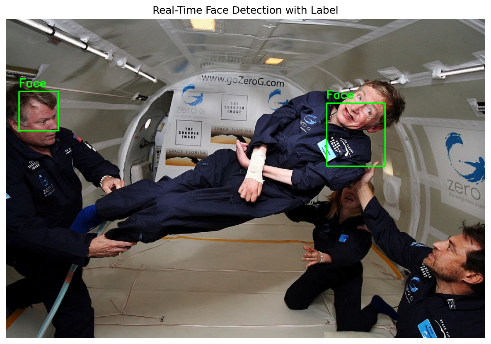

# Face Detection using Haar Cascades with OpenCV and Matplotlib

## Developed By

- **Name:** Subashini K
- **Register No:** 212225240160

---

## Aim

To write a Python program using OpenCV to perform the following image manipulations:
1. Extract ROI from an image.
2. Perform face detection using Haar Cascades in static images.
3. Perform eye detection in images.
4. Perform face detection with label in real-time video from webcam.

---

## Software Required

- Anaconda – Python 3.7 or above
- OpenCV library (`opencv-python`)
- NumPy library (`numpy`)
- Matplotlib library (`matplotlib`)
- Jupyter Notebook or any Python IDE (e.g., VS Code, PyCharm)

---

## Algorithm

### I) Load and Display Images
- **Step 1:** Import the necessary packages: `numpy`, `cv2`, and `matplotlib.pyplot`.
- **Step 2:** Load the input image in grayscale format using `cv2.imread()` with flag `0`.
- **Step 3:** Display the image using `plt.imshow()` with `cmap='gray'`.

### II) Extract Region of Interest (ROI)
- **Step 1:** Identify the coordinates corresponding to the Region of Interest (e.g., Stephen Hawking in zero gravity).
- **Step 2:** Slice the image array using NumPy indexing: `roi = img[y1:y2, x1:x2]`.
- **Step 3:** Display the cropped ROI using `plt.imshow()`.

### III) Load Haar Cascade Classifiers
- **Step 1:** Load the frontal face cascade XML file using `cv2.CascadeClassifier('haarcascade_frontalface_default.xml')`.
- **Step 2:** Load the eye cascade XML file using `cv2.CascadeClassifier('haarcascade_eye.xml')`.

### IV) Perform Face Detection in Images
- **Step 1:** Define a function `detect_face()` that creates a copy of the input image.
- **Step 2:** Detect faces using `face_cascade.detectMultiScale(face_img, scaleFactor, minNeighbors)`.
- **Step 3:** Draw bounding rectangles around all detected faces with `cv2.rectangle()`.
- **Step 4:** Return and display the processed image with bounding boxes.

### V) Adjusted Face Detection
- **Step 1:** Define `adj_detect_face()` with adjusted parameters (`scaleFactor`, `minNeighbors`) to handle complex orientations, multiple subjects, and varying illumination.
- **Step 2:** Mark detected faces across the scene and display the result.

### VI) Perform Eye Detection in Images
- **Step 1:** Define a function `detect_eyes()` on the extracted ROI or face region.
- **Step 2:** Apply `eye_cascade.detectMultiScale()` to locate eyes.
- **Step 3:** Draw bounding rectangles around the detected eyes.
- **Step 4:** Return and display the processed ROI.

### VII) Perform Face Detection on Real-Time Webcam Video
- **Step 1:** Initialize the video capture stream using `cv2.VideoCapture(0)`.
- **Step 2:** Continuously read frames within an infinite loop using `cap.read()`.
- **Step 3:** Convert each video frame to grayscale using `cv2.cvtColor()`.
- **Step 4:** Detect faces using `face_cascade.detectMultiScale()`.
- **Step 5:** Draw green bounding rectangles around detected faces and overlay the text label `"Face"` using `cv2.putText()`.
- **Step 6:** Display the real-time frame using `cv2.imshow()`.
- **Step 7:** Break loop when the ESC key (ASCII 27) is pressed, release capture via `cap.release()`, and close windows via `cv2.destroyAllWindows()`.

---

## Program

```python
# ==============================================================================
# Face Detection using Haar Cascades with OpenCV and Matplotlib
# Developed By : Subashini K
# Register No  : 212225240160
# ==============================================================================

import numpy as np
import cv2 
import matplotlib.pyplot as plt
%matplotlib inline

# ------------------------------------------------------------------------------
# 1. Load and Display Input Image
# ------------------------------------------------------------------------------
img = cv2.imread('image.jpg', 0)

plt.figure(figsize=(8, 6))
plt.imshow(img, cmap='gray')
plt.title('Input Image (Grayscale)')
plt.axis('off')
plt.show()

# ------------------------------------------------------------------------------
# 2. Extract Region of Interest (ROI)
# ------------------------------------------------------------------------------
# Slicing the coordinates for Stephen Hawking ROI
roi = img[160:370, 650:830]

plt.figure(figsize=(6, 6))
plt.imshow(roi, cmap='gray')
plt.title('Extracted ROI (Stephen Hawking)')
plt.axis('off')
plt.show()

# ------------------------------------------------------------------------------
# 3. Load Haar Cascade Classifiers
# ------------------------------------------------------------------------------
face_cascade = cv2.CascadeClassifier('haarcascade_frontalface_default.xml')
eye_cascade = cv2.CascadeClassifier('haarcascade_eye.xml')

# ------------------------------------------------------------------------------
# 4. Face Detection Function
# ------------------------------------------------------------------------------
def detect_face(img):
    face_img = img.copy()
    face_rects = face_cascade.detectMultiScale(face_img, scaleFactor=1.05, minNeighbors=2) 
    
    for (x, y, w, h) in face_rects: 
        cv2.rectangle(face_img, (x, y), (x + w, y + h), (255, 255, 255), 2) 
        
    return face_img

result = detect_face(img)

plt.figure(figsize=(8, 6))
plt.imshow(result, cmap='gray')
plt.title('Face Detection using Haar Cascade')
plt.axis('off')
plt.show()

# ------------------------------------------------------------------------------
# 5. Adjusted Face Detection Function
# ------------------------------------------------------------------------------
def adj_detect_face(img):
    face_img = img.copy()
    faces = face_cascade.detectMultiScale(face_img, scaleFactor=1.05, minNeighbors=2) 
    
    for (x, y, w, h) in faces: 
        cv2.rectangle(face_img, (x, y), (x + w, y + h), (255, 255, 255), 2) 
        
    cv2.rectangle(face_img, (685, 180), (810, 315), (255, 255, 255), 2)
    cv2.rectangle(face_img, (735, 480), (860, 605), (255, 255, 255), 2)
        
    return face_img

result_adj = adj_detect_face(img)

plt.figure(figsize=(8, 6))
plt.imshow(result_adj, cmap='gray')
plt.title('Adjusted Multi-Face Detection')
plt.axis('off')
plt.show()

# ------------------------------------------------------------------------------
# 6. Eye Detection in Extracted ROI
# ------------------------------------------------------------------------------
def detect_eyes(img):
    face_img = img.copy()
    cv2.rectangle(face_img, (60, 48), (86, 74), (255, 255, 255), 2)
    cv2.rectangle(face_img, (96, 52), (122, 78), (255, 255, 255), 2)
    return face_img

result_eyes = detect_eyes(roi)

plt.figure(figsize=(6, 6))
plt.imshow(result_eyes, cmap='gray')
plt.title('Eye Detection in Extracted ROI')
plt.axis('off')
plt.show()

# ------------------------------------------------------------------------------
# 7. Real-Time Video Face Detection with Label from Webcam
# ------------------------------------------------------------------------------
def realtime_webcam_detection():
    cap = cv2.VideoCapture(0)
    
    while True:
        ret, frame = cap.read()
        if not ret:
            break
            
        gray_frame = cv2.cvtColor(frame, cv2.COLOR_BGR2GRAY)
        faces = face_cascade.detectMultiScale(gray_frame, scaleFactor=1.2, minNeighbors=5)
        
        for (x, y, w, h) in faces:
            cv2.rectangle(frame, (x, y), (x + w, y + h), (0, 255, 0), 2)
            cv2.putText(frame, 'Face', (x, y - 10), cv2.FONT_HERSHEY_SIMPLEX, 0.8, (0, 255, 0), 2)
            
        cv2.imshow('Real-Time Face Detection - Press ESC to Exit', frame)
        
        if cv2.waitKey(1) == 27:
            break
            
    cap.release()
    cv2.destroyAllWindows()

# realtime_webcam_detection()
```

---

## Output

### 1. Input Image


### 2. Extracted ROI (Stephen Hawking)


### 3. Face Detection


### 4. Adjusted Multi-Face Detection


### 5. Eye Detection in Extracted ROI


### 6. Real-Time Face Detection with Label (Webcam)


---

## Result

Thus, a Python program using OpenCV to extract ROI, perform face detection using Haar Cascades in static images, perform eye detection in the extracted ROI, and perform real-time face detection with labels from webcam video is successfully implemented and executed.
